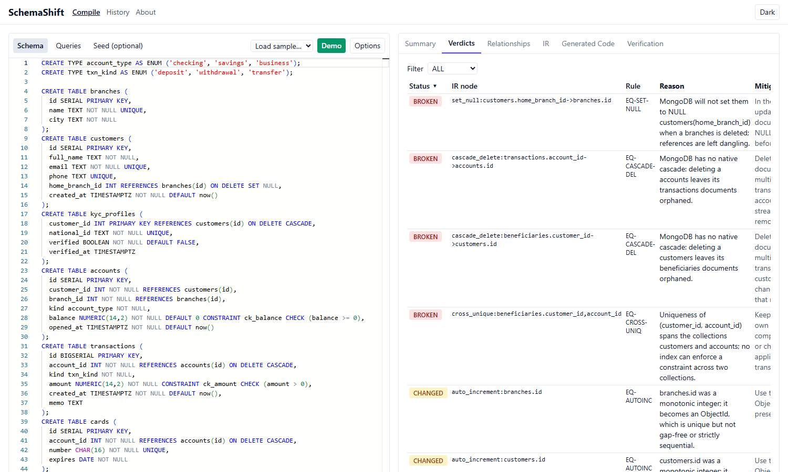
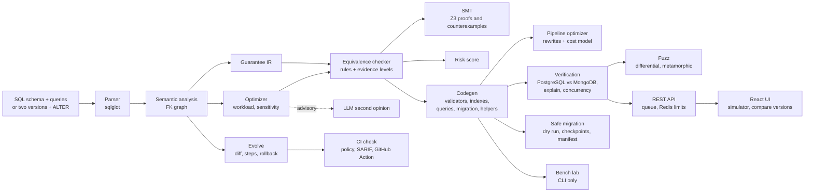

# SchemaShift

[](https://github.com/aryannn229/SchemaShift/actions/workflows/smoke.yml)

SchemaShift is a compiler that migrates a PostgreSQL schema and its queries to MongoDB. It does not
just move data: it works out which **guarantees** the SQL schema gave you (foreign keys, cascades,
uniqueness, NULL and ordering semantics, atomic multi-table writes) and reports, per guarantee,
whether MongoDB keeps it (**SAFE**), changes it (**CHANGED**) or loses it (**BROKEN**). It then picks
embed vs reference for every relationship, generates the MongoDB code, and proves the result by
running the SQL on PostgreSQL and the translated queries on MongoDB against the same data.



The **Demo** button loads the banking sample, compiles it and starts a verified run.

## Architecture



Compiler stages are pure functions over frozen pydantic models. Only `verification/`, `ai/` and
`api/` perform I/O. User SQL is parsed, never executed as text. See `docs/ARCHITECTURE.md`.

## Quickstart (Windows / PowerShell)

```powershell
copy .env.example .env
docker compose up --build
# API docs:  http://localhost:8000/api/docs
# Web app:   http://localhost:5173   (pick "banking" under Load sample, then Compile)
```

Without Docker (compile only, no verification):

```powershell
./scripts/dev.ps1 setup
cd backend; .venv\Scripts\python -m uvicorn schemashift.api.main:app --reload
cd frontend; npm run dev
```

Dev tasks (`./scripts/dev.ps1 <target>` or `just <target>`): `setup`, `dev`, `test`,
`test-integration`, `lint`, `typecheck`, `build`, `migrate`, `evaluate`.

Command line:

```powershell
cd backend
.venv\Scripts\python -m schemashift.cli compile ..\samples\ecommerce\schema.sql --queries ..\samples\ecommerce\queries.sql
.venv\Scripts\python -m schemashift.cli evaluate --write-docs
```

## What you get

| Result tab | Content |
|---|---|
| Summary | Overall verdict, SAFE/CHANGED/BROKEN counts, diagnostics |
| Verdicts | Per-guarantee status, reason, mitigation, "Why?" condition trace, source highlighting |
| Relationships | Graph of tables and FKs, EMBED/REFERENCE decision, score factors, AI opinion, override |
| IR | The printed intermediate representation |
| Generated Code | Validators, indexes, translated queries, migration script, enforcement helpers (mongosh + PyMongo) |
| Verification | Per-query MATCH/MISMATCH with diff and hypothesis, plus probes that demonstrate each BROKEN/CHANGED verdict |

## What is new in Phases 14 to 27

Correctness and evidence: differential and metamorphic fuzzing against PostgreSQL (14 bugs found and fixed), an
independent-corpus protocol with honest metrics (15), evidence levels and minimal counterexamples (16), a concurrency
analyzer with real races (17), workload-aware placement with a sensitivity analysis (18), a cost-based pipeline
optimizer validated against `explain` (19), a benchmark lab (20), a Redis-backed job queue and deploy configs with a smoke
test (21), incremental migrations from two schema versions or ALTER scripts (22), safe migration mode with checkpoints and
resume (23), a transparent risk score and a decision simulator (24), a CI check with SARIF and a GitHub Action (25), and Z3
proofs of validator equivalence checked against the real databases (26). `schemashift evaluate --all` reproduces every
number (27).

## Quality

Headline numbers, each reproduced by `schemashift evaluate --all` (generated results, environment and limits in
`docs/EVALUATION.md`):

| Metric | Value | How to read it |
|---|---|---|
| Detection rate / false positives (32 corpus schemas, 883 labeled guarantees) | 100% / 0% | **self-labeled**: the author wrote the rules and the labels. Independent labels: pending a second person |
| Result-set correctness (21 sample queries, PostgreSQL vs generated MongoDB) | 100% | label-free; hand-written workloads, synthetic data |
| Differential and metamorphic fuzzing | 0 failures in the recorded budget; 14 bugs found and fixed to date | the generator covers a subset of SQL |
| Z3 soundness (random single-table schemas, real PostgreSQL 16 and MongoDB 7) | 1,000 schemas: 863 counterexamples confirmed, 565 proofs, 33,900 random rows agreeing, 0 contradictions | proves formulas under stated assumptions; found 2 bugs in generated validators |
| Evidence levels over 41 schemas | PROVEN 864 to 1,384 with Z3; UNVERIFIED 93 | see `docs/EVALUATION.md` |
| Chosen placement fastest in benchmarks | 1 of 6 queries at 1,000 rows per table | **the optimizer does not optimize latency**; all-EMBED is usually as fast; PostgreSQL was faster on every query |
| Mutation score | 89.1% (stale: before Phase 18) | re-run `scripts/mutation.sh` |
| AI agreement | not measured without an API key | the mock advisor agrees with kappa 0.41 |

## Known limitations

- No independent labels yet; every accuracy figure above is consistency with the author's own rules.
- Embed-vs-reference is decided by correctness-related risk and a heuristic cost, not by measured latency.
- The incremental compiler automates only simple restructurings; everything else is a MANUAL step with a recovery strategy.
- SMT covers row-local constraints on root tables inside a documented fragment; everything else is UNVERIFIED.
- The GitHub Action, the Render/Vercel/Neon/Atlas deployment and the VS Code client have not been run on the real services
  from this repository (the configs, a local prod-like stack and tests are).
- PostgreSQL 16 and MongoDB 7 only.

## Documentation

`SPEC.md` (requirements), `docs/ARCHITECTURE.md`, `docs/IR.md`, `docs/RULES.md` (generated),
`docs/OPTIMIZER.md`, `docs/CODEGEN.md`, `docs/VERIFICATION.md`, `docs/AI.md`,
`docs/SUPPORTED_SQL.md`, `docs/METRICS.md`, `docs/EVALUATION.md`, `docs/FUZZING.md`, `docs/CONCURRENCY.md`,
`docs/PIPELINE_OPTIMIZER.md`, `docs/EVOLUTION.md`, `docs/SAFE_MIGRATION.md`, `docs/SMT.md`, `docs/CI.md`, `docs/DEPLOY.md`,
`docs/DECISIONS.md`, and one `docs/progress/phase-N.md` per phase.

## Deployment

Vercel (frontend), Render (API and worker), Neon (PostgreSQL), MongoDB Atlas, Redis.
Step-by-step instructions, every environment variable, the smoke test and the security checklist are in
`docs/DEPLOY.md`; `docker-compose.prod.yml` runs the same images locally.

## Tests

```powershell
./scripts/dev.ps1 test               # unit tests (backend + frontend)
./scripts/dev.ps1 test-integration   # needs docker-compose.test.yml services
cd frontend; npx playwright test     # E2E (needs the API and dev server running)
```
